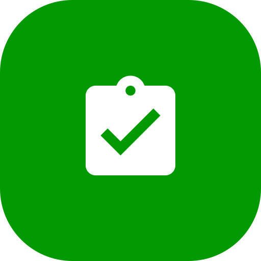
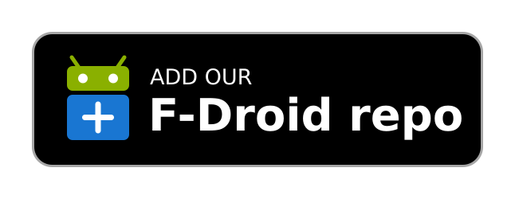
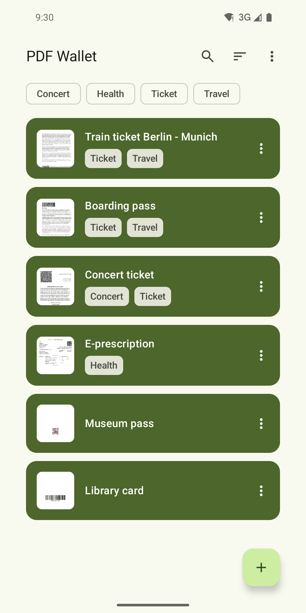
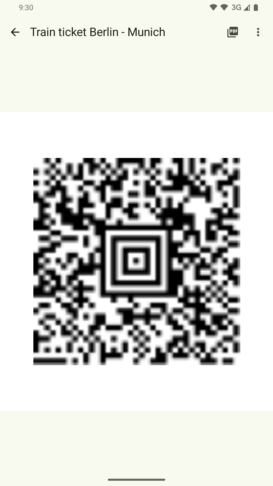
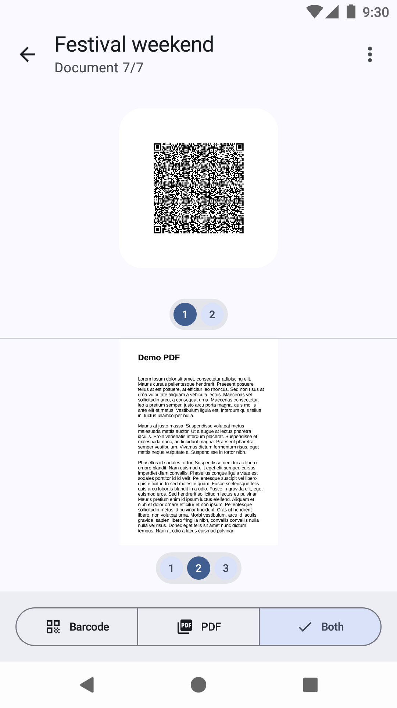
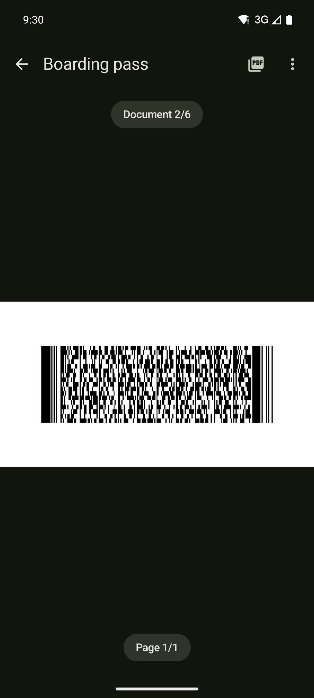

<h1>PDF Docket</h1>

An Android app that stores your PDF tickets, passes and certificates and shows their barcodes in fullscreen.

<p>
  <a href="https://f-droid.org/packages/me.d3sox.pdfwallet/"></a><!--
  --><a href="https://fdroid.link/#https://pdf-docket.d3sox.me/repo?fingerprint=5DE94793532B65A47FF529D0BA9254338AA3879BF3C696AEFA3FAF56D05D08BB"></a><!--
  --><a href="https://apps.obtainium.imranr.dev/redirect?r=obtainium://add/https://github.com/D3SOX/pdf-docket"></a><!--
  --><a href="https://pdf-docket.d3sox.me/#play-test"></a>
</p>

F-Droid builds each release from source and publishes it a few days later. To get new versions on release day, add this project's own F-Droid repository with the second badge. New versions also appear on [GitHub Releases](https://github.com/D3SOX/pdf-docket/releases) right away.

To join the Google Play closed test, first [join the tester group](https://groups.google.com/g/d3sox-apps-testers), then [opt in on Google Play](https://play.google.com/apps/testing/me.d3sox.pdfwallet) with the same Google account. Please stay opted in for at least 14 days, try the app and send feedback via [GitHub Issues](https://github.com/D3SOX/pdf-docket/issues). Google Play, F-Droid and GitHub builds share one signing key, so you can switch between them without reinstalling the app.

   

## Why this fork

PDF Wallet was open source until its author, Michael Troger, archived [the original repository](https://github.com/michaeltroger/pdfwallet-android) and continued the app as the proprietary PDFWallet Vault. Its paid "Pro" features moved behind an in-app purchase.

PDF Docket is a fork of the last open source version and stays under the GPLv3. It has its own interface built with Jetpack Compose and Material 3, and includes the former Pro features for free: tags, tag filters, inverted PDF colors in dark mode, a forced light or dark theme and half-size barcodes.

## Features

- Import one or several PDFs at once, or open them with PDF Docket from a file browser, email client or web browser.
- Detect QR, Aztec, DataMatrix, PDF417, UPC-A, UPC-E, EAN-8, EAN-13, Code 39, Code 93, Code 128, ITF and Codabar barcodes and show them in fullscreen.
- Swipe between documents and switch between the barcode and the PDF, or show both in split screen. In split screen, the PDF turns to the page of the barcode you swipe to.
- Reopen a document at the barcode and page you left it on.
- Tag documents and give each tag an icon.
- Search and sort documents by import date, name or file size, and show them as a grid or a list.
- Select several documents to tag, share or delete them together.
- Add a document to the home screen to open it with one tap.
- Back up all documents and tags to a password-encrypted file and restore them on another device.
- Open password protected PDFs and lock the app with biometrics or the device PIN.
- Use a light or dark theme, in blue or in your system colors on Android 12 and later.
- Work offline, with no internet permission, ads or tracking.

## Building

The app requires JDK 21 to build and runs on Android 7.0 or later.

```sh
./gradlew assembleDebug
./gradlew detekt lintDebug testDebugUnitTest
```

To publish a release, bump `versionCode` and `versionName` in `app/build.gradle.kts`, then push a matching annotated version tag. Its message becomes the changelog of the GitHub release. The release workflow builds the signed APK and App Bundle, creates the GitHub release and updates the F-Droid repository.

```sh
git tag -a v1.1.0 -F changelog.md && git push origin v1.1.0
```

## License

GNU General Public License v3.0. See [LICENSE](LICENSE).
