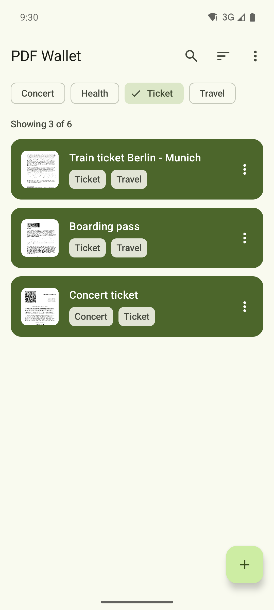

<h1>PDF Wallet Revived</h1>

An Android app that stores your PDF tickets, passes and certificates and shows their barcodes in fullscreen.

<p>
  <a href="https://fdroid.link/#https://pdfwallet.d3sox.me/repo?fingerprint=5DE94793532B65A47FF529D0BA9254338AA3879BF3C696AEFA3FAF56D05D08BB"></a>
  <a href="https://apps.obtainium.imranr.dev/redirect?r=obtainium://add/https://github.com/D3SOX/pdfwallet"></a>
  <a href="https://pdfwallet.d3sox.me/#play-test"></a>
</p>

The F-Droid badge opens this project's own F-Droid repository, which you add to your F-Droid client. New versions appear there and on [GitHub Releases](https://github.com/D3SOX/pdfwallet/releases).

To join the Google Play closed test, first [join the tester group](https://groups.google.com/g/d3sox-apps-testers), then [opt in on Google Play](https://play.google.com/apps/testing/me.d3sox.pdfwallet) with the same Google account. Please stay opted in for at least 14 days, try the app and send feedback via [GitHub Issues](https://github.com/D3SOX/pdfwallet/issues). Google Play, F-Droid and GitHub builds share one signing key, so you can switch between them without reinstalling the app.

   

## Why this fork

PDF Wallet was open source until its author, Michael Troger, archived [the original repository](https://github.com/michaeltroger/pdfwallet-android) and continued the app as the proprietary PDFWallet Vault. Its paid "Pro" features moved behind an in-app purchase.

This fork keeps the app open source under the GPLv3. It rebuilds the interface with Jetpack Compose and Material 3, modeled on the new app, and includes the former Pro features for free: tags, tag filters, inverted PDF colors in dark mode, a forced light or dark theme and half-size barcodes.

## Features

- Import one or several PDFs at once, or open them with PDF Wallet Revived from a file browser, email client or web browser.
- Detect QR, Aztec, DataMatrix, PDF417, UPC-A, UPC-E, EAN-8, EAN-13, Code 39, Code 93, Code 128, ITF and Codabar barcodes and show them in fullscreen.
- Swipe between documents and switch between the barcode and the PDF, or show both in split screen.
- Tag, search and sort documents by import date, name or file size.
- Select several documents to tag, share or delete them together.
- Add a document to the home screen to open it with one tap.
- Back up all documents and tags to a password-encrypted file and restore them on another device.
- Open password protected PDFs and lock the app with biometrics or the device PIN.
- Use a light or dark theme, in blue or in your system colors on Android 12 and later.
- Work offline, with no internet permission, ads or tracking.

## Building

The app requires JDK 21 to build and runs on Android 7.0 or later.

```sh
./gradlew assembleDebug
./gradlew detekt lintDebug testDebugUnitTest
```

To publish a release, bump `versionCode` and `versionName` in `app/build.gradle.kts`, then push a matching version tag. The release workflow builds the signed APK and App Bundle, creates the GitHub release and updates the F-Droid repository.

```sh
git tag v1.1.0 && git push origin v1.1.0
```

## License

GNU General Public License v3.0. See [LICENSE](LICENSE).
